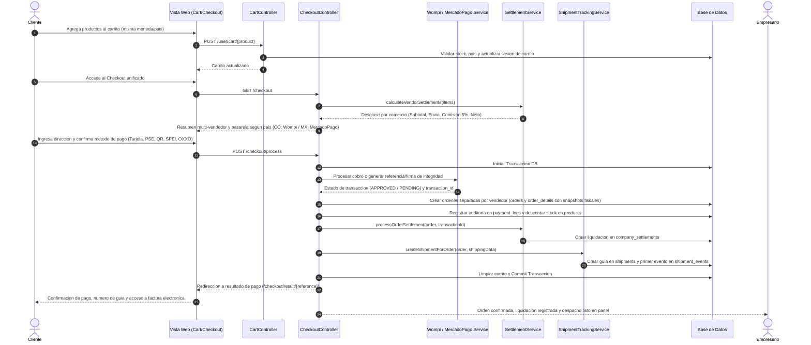
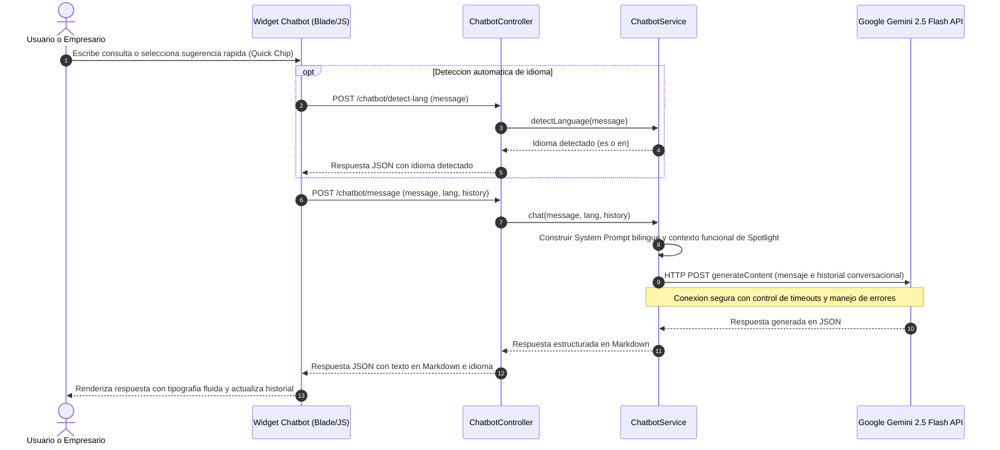

# 📋 Especificación de Casos de Uso - Spotlight

Documento formal de especificación y modelado de Casos de Uso para el sistema **Spotlight**, desarrollado sobre Laravel 12, MySQL, Bootstrap 5, arquitectura multinacional (Colombia 🇨🇴 y México 🇲🇽), pasarelas de pago integradas (Wompi y Mercado Pago), Facturación Electrónica DIAN (UBL 2.1 / Factus), rastreo logístico en tiempo real e integración con Inteligencia Artificial (Google Gemini).

---

## 👥 Actores del Sistema

| Actor | Tipo | Descripción |
| :--- | :--- | :--- |
| **Visitante (Guest)** | Humano | Usuario no autenticado que explora el marketplace multinacional, productos, reseñas, perfiles de empresas y el portal público de rastreo de envíos. |
| **Cliente (User)** | Humano | Comprador registrado; gestiona carrito multi-vendedor, checkout (Wompi CO / Mercado Pago MX), compras internacionales asistidas (CO ↔ MX), rastreo de pedidos, descarga de facturas DIAN, reseñas verificadas y mapa interactivo. |
| **Empresario (Business)** | Humano | Vendedor encargado de administrar perfil comercial, horarios, datos bancarios/dispersión, catálogo e inventario PDF, gastos operativos con soportes PDF, despachos/guías, compras asistidas, guía de formalización y facturación electrónica DIAN. |
| **Administrador (Admin)** | Humano | Superusuario responsable de la moderación de usuarios, auditoría de empresas, verificación de perfiles fiscales DIAN, supervisión de compras internacionales asistidas y reportes globales bajo políticas de privacidad. |
| **Servicio Google OAuth** | Externo / Sistema | Proveedor de autenticación social federada (OAuth 2.0). |
| **Servicio de Correo (SMTP / Resend)** | Externo / Sistema | Emisor de correos transaccionales, códigos OTP y notificaciones de estado empresarial. |
| **API Google Gemini (IA)** | Externo / Sistema | Motor de procesamiento de lenguaje natural y asistencia inteligente bilingüe (ES/EN). |
| **Pasarelas de Pago (Wompi / Mercado Pago)** | Externo / Sistema | Procesadores de pago para Colombia (Tarjeta, PSE, Nequi, QR Bancolombia) y México (Tarjeta, SPEI, OXXO) con notificación vía Webhooks. |
| **Proveedor Tecnológico DIAN (Factus / Sandbox)** | Externo / Sistema | Motor de validación previa DIAN UBL 2.1 para emisión de Facturas Electrónicas, Notas Crédito/Débito, cálculo de CUFE/CUDE y generación de XML/PDF. |
| **Operadores Logísticos (APIs Transportadoras)** | Externo / Sistema | Servicios de transporte (Coordinadora, Servientrega, Inter Rapidísimo, Envía, DHL, Spotlight Express) para generación de guías y telemetría de rastreo. |

---

## 🗺️ Diagrama General de Casos de Uso (Mermaid)

```mermaid
flowchart LR
    subgraph Actores["Actores del Sistema"]
        A_Guest["Visitante (Guest)"]
        A_User["Cliente (User)"]
        A_Business["Empresario (Business)"]
        A_Admin["Administrador (Admin)"]
    end

    subgraph Mod_Auth["Modulo 1: Autenticacion y Cuenta"]
        CU01(["CU01: Registrarse Usuario o Empresa"])
        CU02(["CU02: Iniciar Sesion"])
        CU03(["CU03: Autenticacion con Google OAuth"])
        CU04(["CU04: Verificar Codigo OTP Email"])
        CU05(["CU05: Cerrar Sesion"])
        CU06(["CU06: Actualizar Perfil y Ubicacion Multinacional"])
    end

    subgraph Mod_Commerce["Modulo 2: Marketplace, Pagos y Logistica Cliente"]
        CU07(["CU07: Explorar Catalogo Multinacional CO y MX"])
        CU08(["CU08: Ver Geolocalizacion y Horarios en Mapa"])
        CU09(["CU09: Gestionar Carrito Multi-Vendedor"])
        CU10(["CU10: Checkout Multi-Pasarela Wompi y MercadoPago"])
        CU11(["CU11: Consultar Pedidos, Rastreo y Factura DIAN"])
        CU12(["CU12: Calificar y Resenar Productos Verificados"])
        CU13(["CU13: Solicitar Compra Internacional Asistida CO-MX"])
        CU31(["CU31: Consultar Portal Publico de Rastreo de Guias"])
    end

    subgraph Mod_Business["Modulo 3: Gestion Empresarial, Envios y Facturacion DIAN"]
        CU14(["CU14: Gestionar Empresa, Horarios y Cuenta Bancaria Split"])
        CU15(["CU15: Actualizar Documentos y Guia de Formalizacion"])
        CU16(["CU16: Gestionar Productos, Costos y Exportar PDF"])
        CU17(["CU17: Gestionar Gastos, Soportes y Exportar PDF"])
        CU18(["CU18: Gestionar Despachos, Guias y Estados de Envio"])
        CU19(["CU19: Configurar Perfil Fiscal y Emitir Facturas/Notas DIAN"])
        CU20(["CU20: Negociar y Gestionar Compras Asistidas CO-MX"])
        CU21(["CU21: Visualizar Dashboard Empresarial y Liquidaciones"])
    end

    subgraph Mod_Admin["Modulo 4: Administracion, Verificacion Fiscal y Auditoria"]
        CU22(["CU22: Administrar Usuarios"])
        CU23(["CU23: Administrar y Auditar Empresas"])
        CU24(["CU24: Verificar y Habilitar Perfiles Fiscales DIAN"])
        CU25(["CU25: Moderar Productos de Tiendas"])
        CU26(["CU26: Supervisar Compras Internacionales Asistidas"])
        CU27(["CU27: Consultar Reportes y Metricas Globales"])
        CU28(["CU28: Visualizar Dashboard General con Privacidad"])
    end

    subgraph Mod_Communication["Modulo 5: Comunicacion e IA"]
        CU29(["CU29: Mensajeria Directa Chat Cliente-Empresa"])
        CU30(["CU30: Consultar Asistente IA Bilingue Spotlight"])
    end

    A_Guest --> CU01
    A_Guest --> CU02
    A_Guest --> CU03
    A_Guest --> CU07
    A_Guest --> CU31

    A_User --> CU04
    A_User --> CU05
    A_User --> CU06
    A_User --> CU07
    A_User --> CU08
    A_User --> CU09
    A_User --> CU10
    A_User --> CU11
    A_User --> CU12
    A_User --> CU13
    A_User --> CU29
    A_User --> CU30
    A_User --> CU31

    A_Business --> CU05
    A_Business --> CU14
    A_Business --> CU15
    A_Business --> CU16
    A_Business --> CU17
    A_Business --> CU18
    A_Business --> CU19
    A_Business --> CU20
    A_Business --> CU21
    A_Business --> CU29
    A_Business --> CU30

    A_Admin --> CU05
    A_Admin --> CU22
    A_Admin --> CU23
    A_Admin --> CU24
    A_Admin --> CU25
    A_Admin --> CU26
    A_Admin --> CU27
    A_Admin --> CU28
    A_Admin --> CU29
    A_Admin --> CU30
```

---

## 🔄 Diagrama de Secuencia: Flujo de Compra, Checkout Multi-Pasarela, Liquidación y Rastreo

---

## 🤖 Diagrama de Secuencia: Interacción con Asistente IA (Gemini)

---

## 📑 Catálogo Detallado de Casos de Uso

### Módulo 1: Autenticación y Gestión de Cuenta

#### CU01: Registrarse en la Plataforma (Comprador o Empresa Formal/Informal)
- **Actor:** Visitante (Guest)
- **Precondición:** El visitante no debe tener sesión activa.
- **Flujo Principal:**
  1. El visitante accede a `/register`.
  2. Selecciona si desea registrarse como Comprador (`user`) o Empresario (`business`), eligiendo país de operación (Colombia 🇨🇴 o México 🇲🇽).
  3. Si es empresa, especifica tipo de negocio (`formal` con NIT/RFC, Cámara de Comercio y RUT, o `informal` con datos del propietario y RUT personal) y acepta Habeas Data.
  4. El sistema valida los campos (`BusinessRegisterRequest`), crea el usuario y la empresa, y redirige al panel correspondiente.

#### CU02: Iniciar Sesión con Credenciales
- **Actor:** Visitante (Guest)
- **Flujo Principal:**
  1. El usuario accede a `/login`, ingresa correo y contraseña.
  2. El sistema valida credenciales y estado activo de la cuenta.
  3. Redirección automática según rol (`/admin/dashboard`, `/business/dashboard` o `/user/dashboard`).

#### CU03: Autenticación Social con Google OAuth
- **Actor:** Visitante / Usuario
- **Flujo Principal:**
  1. El usuario selecciona "Continuar con Google" (`/auth/google`).
  2. Google retorna identidad a `/auth/google/callback`.
  3. Si requiere verificación adicional, el sistema envía código OTP al correo electrónico.

#### CU04: Verificación de Correo con Código OTP
- **Actor:** Cliente / Usuario
- **Flujo Principal:**
  1. El sistema envía código numérico vía `GoogleVerificationMail`.
  2. El usuario ingresa el código en `/email/verify/form` y activa su cuenta.

#### CU06: Actualizar Perfil y Ubicación Multinacional
- **Actor:** Cliente
- **Descripción:** Permite actualizar datos personales, avatar, teléfono con prefijo internacional (`+57` / `+52`), dirección, ciudad, departamento/estado, código postal y país en `/user/profile`.

---

### Módulo 2: Marketplace, Pagos Multi-Pasarela y Logística (Cliente)

#### CU07: Explorar Catálogo Multinacional (CO / MX) y Tiendas
- **Actor:** Visitante / Cliente
- **Descripción:** Exploración de productos con filtros por país (`CO` / `MX`), moneda (`COP` / `MXN`), categoría y búsqueda por texto, con acceso al detalle de producto (`/productos/{product}`) y perfil público de empresa (`/empresas/{company}`).

#### CU08: Mapa Interactivo de Comercios y Horarios
- **Actor:** Cliente
- **Descripción:** Visualización en `/user/map` de comercios geolocalizados con indicadores en tiempo real de horario de atención (`Abierto` / `Cerrado`), calificación promedio y enlace directo a la tienda.

#### CU09: Gestión de Carrito Multi-Vendedor
- **Actor:** Cliente
- **Descripción:** Permite agregar productos de múltiples comercios validando consistencia de moneda/país para pago directo, o sugiriendo Compra Internacional Asistida cuando el producto pertenece a otro país.

#### CU10: Checkout Multi-Pasarela (Wompi Colombia / Mercado Pago México)
- **Actor:** Cliente
- **Flujo Principal:**
  1. El comprador accede a `/checkout` y revisa el desglose por comercio.
  2. Para tiendas en **Colombia (COP)**, paga mediante **Wompi** (Tarjeta de crédito/débito, PSE con autorización bancaria, Nequi o QR Bancolombia).
  3. Para tiendas en **México (MXN)**, paga mediante **Mercado Pago** (Tarjeta, transferencia SPEI o efectivo en OXXO).
  4. El sistema divide el carrito creando una orden (`Order`) por cada empresa vendedora, calcula la comisión de la plataforma (`SettlementService`), registra logs de pago (`PaymentLog`) y genera automáticamente la guía de despacho (`Shipment`).

#### CU11: Consultar Historial de Pedidos, Rastreo en Vivo y Factura DIAN
- **Actor:** Cliente
- **Descripción:** Desde `/user/orders`, el comprador consulta sus órdenes, visualiza el mapa y línea de tiempo de rastreo logístico (`/user/orders/{order}/tracking`) y descarga la Representación Gráfica PDF de su Factura Electrónica DIAN (`/user/orders/{order}/invoice`).

#### CU12: Calificar y Reseñar Productos Verificados
- **Actor:** Cliente
- **Descripción:** Publicación de calificaciones (1 a 5 estrellas) y comentarios sobre productos en `/productos/{product}/reviews`, marcando automáticamente el sello de "Compra Verificada" si el usuario adquirió el producto.

#### CU13: Solicitar y Gestionar Compra Internacional Asistida (CO ↔ MX)
- **Actor:** Cliente
- **Descripción:** Cuando un comprador en Colombia desea adquirir un producto de México (o viceversa), crea una solicitud en `/user/assisted-purchases`, negocia costos de envío internacional y aranceles con el vendedor, registra el pago acordado y realiza seguimiento del envío transfronterizo.

#### CU31: Consultar Portal Público de Rastreo de Guías
- **Actor:** Visitante / Cliente
- **Descripción:** Consulta pública sin necesidad de iniciar sesión en `/rastreo` o vía API REST (`/api/v1/tracking/{tracking_number}`) ingresando el número de guía de cualquier transportadora aliada.

---

### Módulo 3: Gestión Empresarial, Logística y Facturación Electrónica DIAN (Business)

#### CU14: Gestionar Perfil de Empresa, Horarios y Cuenta Bancaria (Split)
- **Actor:** Empresario
- **Descripción:** Configuración de información comercial, ubicación en mapa, horarios de apertura/cierre, días de operación y datos bancarios (`bank_name`, `account_type`, `account_number`, `wompi_merchant_id`, `split_rule_id`) para dispersión de fondos.

#### CU15: Solicitar Actualización de Documentos y Guía de Formalización
- **Actor:** Empresario
- **Descripción:** Carga de soporte documental para auditoría administrativa y acceso al módulo educativo interactivo `/business/formalization-guide` para que negocios informales conozcan el paso a paso de formalización mercantil y tributaria (RUT, Cámara de Comercio, DIAN).

#### CU16: Gestionar Catálogo de Productos, Costos e Inventario PDF
- **Actor:** Empresario
- **Descripción:** CRUD completo de productos (`/business/products`) incluyendo SKU, precio de venta, costo unitario (`cost_price`), margen de ganancia, tributos DIAN (`tax_type`, `tax_rate`, `unit_measure`, `standard_code`) y exportación de reporte de inventario en PDF (`/business/products/export-pdf`).

#### CU17: Gestionar Gastos Operativos, Soportes y Reporte PDF
- **Actor:** Empresario
- **Descripción:** CRUD completo de egresos (`/business/expenses`) con categorización, carga de facturas/soportes en PDF o imagen (`invoice_path`) y exportación consolidada en PDF (`/business/expenses/export-pdf`).

#### CU18: Gestionar Despachos, Guías y Estados de Envío
- **Actor:** Empresario
- **Descripción:** En `/business/shipments`, el vendedor asigna transportadora (Coordinadora, Servientrega, Inter Rapidísimo, Envía, DHL, Spotlight Express), despacha pedidos y actualiza los eventos de rastreo en tiempo real.

#### CU19: Configurar Perfil Fiscal, Resolución DIAN y Emitir Facturas / Notas Electrónicas
- **Actor:** Empresario (Comercio Formal en Colombia)
- **Descripción:** Módulo integral `/business/billing` protegido por `EnsureColombianBilling`:
  - Registro de perfil fiscal (`CompanyFiscalProfile`) con cálculo automático de DV (Módulo 11), régimen tributario, responsabilidades DIAN y carga de RUT/Cámara de Comercio.
  - Configuración técnica (`BillingConfiguration`) de proveedor (`Sandbox` UBL 2.1 o `Factus`), resolución DIAN, prefijos, rangos y clave técnica.
  - Emisión de Facturas Electrónicas de Venta (`01`) desde órdenes del marketplace o facturación directa, Notas Crédito (`91`) y Notas Débito (`92`) con cálculo SHA-384 de CUFE/CUDE, descarga de XML UBL 2.1, PDF con QR DIAN y reportes tributarios de IVA.

#### CU20: Negociar y Gestionar Compras Internacionales Asistidas
- **Actor:** Empresario
- **Descripción:** En `/business/assisted-purchases`, el comercio cotiza costos de envío internacional y tasas aplicables, confirma la recepción del pago del comprador e ingresa la guía internacional de despacho.

#### CU21: Visualizar Dashboard Empresarial y Liquidaciones
- **Actor:** Empresario
- **Descripción:** Panel analítico con métricas de ingresos brutos, comisiones de plataforma, pagos netos liquidados (`CompanySettlement`), costos de inventario, gastos operativos y utilidad neta.

---

### Módulo 4: Administración, Verificación Fiscal y Auditoría (Admin)

#### CU22: Administrar Usuarios
- **Actor:** Administrador
- **Descripción:** Gestión de cuentas de usuario (`/admin/users`), creación, edición y activación/suspensión (`toggleActive`).

#### CU23: Administrar y Auditar Empresas
- **Actor:** Administrador
- **Descripción:** Revisión de comercios registrados (`/admin/companies`), cambio de estado (`active`, `inactive`, `pending`) con notificación por correo (`CompanyStatusUpdatedMail`) y aprobación/rechazo de actualizaciones de documentos legales.

#### CU24: Verificar y Habilitar Perfiles Fiscales DIAN
- **Actor:** Administrador
- **Descripción:** En `/admin/fiscal-verifications`, el administrador audita el RUT, Cámara de Comercio y NIT de las empresas formales colombianas, aprobando (`verify`), rechazando (`reject`) o suspendiendo (`suspend`) su habilitación para emitir facturación electrónica DIAN.

#### CU25: Moderar Productos de Tiendas
- **Actor:** Administrador
- **Descripción:** Supervisión del catálogo global (`/admin/products`) con facultad de desactivar o eliminar productos que infrinjan políticas (respetando el bloqueo de integridad contable si el producto tiene ventas o facturas asociadas).

#### CU26: Supervisar Compras Internacionales Asistidas
- **Actor:** Administrador
- **Descripción:** Monitoreo global en `/admin/assisted-purchases` de todas las operaciones transfronterizas (`CO ↔ MX`), estados de negociación y cumplimiento logístico.

#### CU27 y CU28: Reportes Globales y Dashboard con Restricción de Privacidad
- **Actor:** Administrador
- **Descripción:** Visualización de indicadores macro de la plataforma (`/admin/dashboard` y `/admin/reports`) garantizando la privacidad financiera interna de cada comercio (sin exponer gastos privados ni contabilidad interna de las tiendas).

---

### Módulo 5: Comunicación e Inteligencia Artificial

#### CU29: Mensajería Directa (Chat Cliente - Empresa)
- **Actor:** Cliente, Empresario, Administrador
- **Descripción:** Sistema de mensajería interna en tiempo real (`/chat`) con polling de mensajes y contador de no leídos.

#### CU30: Consultar Asistente Virtual IA Bilingüe (Spotlight Bot)
- **Actor:** Cliente, Empresario, Administrador
- **Descripción:** Asistente inteligente conectado a Google Gemini 2.5 Flash (`/chatbot`) con detección automática de idioma (Español/Inglés), historial conversacional y orientación sobre compras, envíos, formalización y facturación electrónica.

---

## 📊 Matriz de Trazabilidad (Roles vs Casos de Uso)

| ID | Caso de Uso | Visitante | Cliente | Empresario | Admin |
| :---: | :--- | :---: | :---: | :---: | :---: |
| **CU01** | Registro de Usuario o Empresa (CO/MX) | ✅ | ❌ | ❌ | ❌ |
| **CU02** | Inicio de Sesión | ✅ | ❌ | ❌ | ❌ |
| **CU03** | Autenticación Google OAuth | ✅ | ❌ | ❌ | ❌ |
| **CU04** | Verificación OTP Email | ❌ | ✅ | ❌ | ❌ |
| **CU05** | Cerrar Sesión | ❌ | ✅ | ✅ | ✅ |
| **CU06** | Actualizar Perfil y Ubicación Multinacional | ❌ | ✅ | ❌ | ❌ |
| **CU07** | Explorar Catálogo Multinacional (CO/MX) | ✅ | ✅ | ✅ | ✅ |
| **CU08** | Ver Mapa Interactivo y Horarios de Tiendas | ❌ | ✅ | ❌ | ❌ |
| **CU09** | Gestionar Carrito Multi-Vendedor | ❌ | ✅ | ❌ | ❌ |
| **CU10** | Checkout Multi-Pasarela (Wompi / MercadoPago) | ❌ | ✅ | ❌ | ❌ |
| **CU11** | Historial de Pedidos, Rastreo y Factura DIAN | ❌ | ✅ | ❌ | ❌ |
| **CU12** | Calificar y Reseñar Productos Verificados | ❌ | ✅ | ❌ | ❌ |
| **CU13** | Solicitar Compra Internacional Asistida (CO-MX) | ❌ | ✅ | ❌ | ❌ |
| **CU14** | Gestionar Empresa, Horarios y Cuenta Split | ❌ | ❌ | ✅ | ❌ |
| **CU15** | Actualizar Documentos y Guía Formalización | ❌ | ❌ | ✅ | ❌ |
| **CU16** | CRUD Productos, Costos y Reporte PDF | ❌ | ❌ | ✅ | ❌ |
| **CU17** | CRUD Gastos, Soportes y Reporte PDF | ❌ | ❌ | ✅ | ❌ |
| **CU18** | Gestionar Despachos, Guías y Envíos | ❌ | ❌ | ✅ | ❌ |
| **CU19** | Facturación Electrónica DIAN (Facturas/Notas) | ❌ | ❌ | ✅ | ❌ |
| **CU20** | Negociar Compras Internacionales Asistidas | ❌ | ❌ | ✅ | ❌ |
| **CU21** | Dashboard Empresarial y Liquidaciones | ❌ | ❌ | ✅ | ❌ |
| **CU22** | Administrar Usuarios | ❌ | ❌ | ❌ | ✅ |
| **CU23** | Administrar y Auditar Empresas | ❌ | ❌ | ❌ | ✅ |
| **CU24** | Verificar Perfiles Fiscales DIAN | ❌ | ❌ | ❌ | ✅ |
| **CU25** | Moderar Productos de Tiendas | ❌ | ❌ | ❌ | ✅ |
| **CU26** | Supervisar Compras Internacionales Asistidas | ❌ | ❌ | ❌ | ✅ |
| **CU27** | Reportes y Métricas Globales | ❌ | ❌ | ❌ | ✅ |
| **CU28** | Dashboard General con Privacidad | ❌ | ❌ | ❌ | ✅ |
| **CU29** | Mensajería Directa (Chat) | ❌ | ✅ | ✅ | ✅ |
| **CU30** | Asistente Virtual con IA (Gemini) | ❌ | ✅ | ✅ | ✅ |
| **CU31** | Portal Público de Rastreo de Guías | ✅ | ✅ | ✅ | ✅ |
