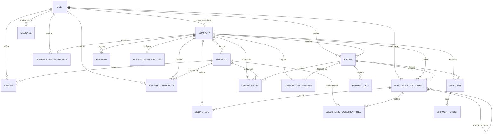
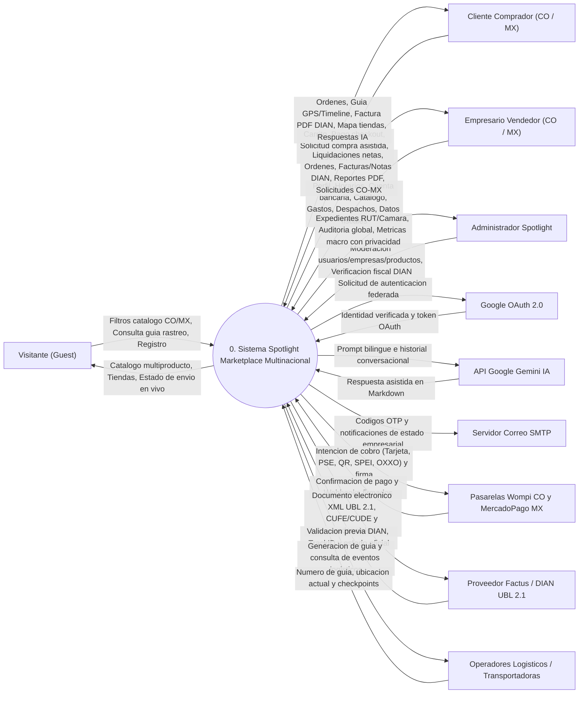

# 🏗️ Documentación de Arquitectura y Diagramas del Sistema - Spotlight

Documento técnico que reúne el **Diagrama Entidad-Relación (Conceptual)**, **Diagrama Físico de Base de Datos**, **Diagramas de Clases UML (Dominio y Aplicación)**, **Diagrama de Componentes y Arquitectura** y **Diagramas de Flujo de Datos (DFD Nivel 0 y Nivel 1)** del proyecto **Spotlight** (Marketplace Multinacional Colombia 🇨🇴 y México 🇲🇽 con Pasarelas Wompi / Mercado Pago, Facturación Electrónica DIAN UBL 2.1, Rastreo Logístico en Tiempo Real, Compras Internacionales Asistidas e IA con Google Gemini).

---

## 1. 🗂️ Diagrama Entidad-Relación (Modelo Conceptual)

Representa las **18 entidades principales** del dominio de negocio y la cardinalidad de sus relaciones conceptuales:

- Un **Usuario** (`USER`) con rol empresarial posee o administra una **Empresa** (`COMPANY`) `(1:1)`.
- Un **Usuario** (`USER`) con rol comprador realiza cero o muchos **Pedidos** (`ORDER`) `(1:N)`, publica **Reseñas** (`REVIEW`) `(1:N)` y solicita **Compras Internacionales Asistidas** (`ASSISTED_PURCHASE`) `(1:N)`.
- Un **Usuario** (`USER`) envía y recibe cero o muchos **Mensajes** (`MESSAGE`) `(1:N)`.
- Un **Usuario Administrador** (`USER`) verifica perfiles fiscales de empresas (`COMPANY_FISCAL_PROFILE`) `(1:N)`.
- Una **Empresa** (`COMPANY`) publica **Productos** (`PRODUCT`) `(1:N)`, registra **Gastos Operativos** (`EXPENSE`) `(1:N)`, recibe **Pedidos** (`ORDER`) `(1:N)`, genera **Liquidaciones Financieras** (`COMPANY_SETTLEMENT`) `(1:N)`, gestiona **Despachos Logísticos** (`SHIPMENT`) `(1:N)` y atiende **Compras Asistidas** (`ASSISTED_PURCHASE`) `(1:N)`.
- Una **Empresa Formal en Colombia** (`COMPANY`) posee un **Perfil Fiscal DIAN** (`COMPANY_FISCAL_PROFILE`) `(1:1)`, una **Configuración de Facturación** (`BILLING_CONFIGURATION`) `(1:1)`, emite **Documentos Electrónicos** (`ELECTRONIC_DOCUMENT`) `(1:N)` y registra **Logs de Facturación** (`BILLING_LOG`) `(1:N)`.
- Un **Producto** (`PRODUCT`) se incluye en **Detalles de Pedido** (`ORDER_DETAIL`) `(1:N)`, recibe **Reseñas** (`REVIEW`) `(1:N)`, se referencia en **Ítems de Documento Electrónico** (`ELECTRONIC_DOCUMENT_ITEM`) `(1:N)` y en **Compras Asistidas** (`ASSISTED_PURCHASE`) `(1:N)`.
- Un **Pedido** (`ORDER`) contiene **Detalles de Pedido** (`ORDER_DETAIL`) `(1:N)`, genera una **Liquidación de Comercio** (`COMPANY_SETTLEMENT`) `(1:1)`, registra **Logs de Pasarela de Pago** (`PAYMENT_LOG`) `(1:N)`, origina un **Envío Logístico** (`SHIPMENT`) `(1:1)` y respalda **Documentos Electrónicos DIAN** (`ELECTRONIC_DOCUMENT`) `(1:N)`.
- Un **Envío** (`SHIPMENT`) registra múltiples **Eventos de Rastreo** (`SHIPMENT_EVENT`) `(1:N)`.
- Un **Documento Electrónico** (`ELECTRONIC_DOCUMENT`) contiene **Ítems de Factura/Nota** (`ELECTRONIC_DOCUMENT_ITEM`) `(1:N)`, registra **Logs de Transmisión** (`BILLING_LOG`) `(1:N)` y puede originar **Notas Crédito o Débito Asociadas** (`ELECTRONIC_DOCUMENT`) `(1:N)`.

---

## 2. 🗄️ Diagrama Físico de Base de Datos (Esquema Relacional)

Especificación detallada de todas las tablas de la base de datos relacional (MySQL), incluyendo llaves primarias (`PK`), llaves foráneas (`FK`), llaves únicas (`UK`) y tipos de datos definidos en las migraciones de Laravel:

```mermaid
erDiagram
    users {
        bigint id PK
        varchar name
        varchar email UK
        varchar password
        varchar google_id
        timestamp email_verified_at
        enum role "user, business, admin"
        varchar phone
        varchar phone_prefix
        varchar address
        varchar city
        varchar state
        varchar postal_code
        varchar country
        date birthdate
        varchar document
        varchar avatar
        boolean active
        varchar remember_token
        timestamp created_at
        timestamp updated_at
    }

    companies {
        bigint id PK
        bigint user_id FK
        varchar country "CO, MX"
        varchar state
        varchar city
        varchar postal_code
        varchar currency "COP, MXN"
        varchar phone_prefix
        varchar tax_id
        varchar name
        enum tipo_negocio "formal, informal"
        varchar razon_social
        varchar nit
        varchar camara_comercio_file
        varchar rut_file
        varchar nombre_representante
        varchar email_representante
        varchar nombre_comercial
        varchar cedula_propietario
        varchar rut_personal_file
        boolean habeas_data_accepted
        varchar logo
        varchar banner
        text description
        varchar category
        varchar address
        varchar phone
        varchar email
        varchar instagram
        varchar facebook
        varchar website
        varchar opening_time
        varchar closing_time
        json operating_days
        varchar bank_name
        varchar account_type
        varchar account_number
        varchar account_holder_name
        varchar account_holder_doc_type
        varchar account_holder_doc_number
        varchar wompi_merchant_id
        varchar split_rule_id
        decimal latitude "10,8"
        decimal longitude "11,8"
        enum status "active, inactive, pending"
        varchar document_update_status
        text document_update_reason
        timestamp created_at
        timestamp updated_at
    }

    products {
        bigint id PK
        bigint company_id FK
        varchar country "CO, MX"
        varchar name
        varchar sku
        text description
        decimal price "10,2"
        decimal cost_price "10,2"
        varchar currency "COP, MXN"
        varchar tax_type "01 IVA, 04 INC, ZZ"
        decimal tax_rate "5,2"
        varchar unit_measure "94 Unidad"
        varchar standard_code
        int stock
        varchar image
        boolean active
        boolean featured
        timestamp created_at
        timestamp updated_at
    }

    reviews {
        bigint id PK
        bigint product_id FK
        bigint user_id FK
        tinyint rating "1 a 5"
        text comment
        boolean is_verified_purchase
        timestamp created_at
        timestamp updated_at
    }

    orders {
        bigint id PK
        bigint user_id FK
        bigint company_id FK
        varchar country "CO, MX"
        varchar reference UK
        varchar payment_reference
        varchar transaction_id
        varchar payment_method
        varchar payment_gateway "wompi, mercadopago"
        varchar payment_status "pending, approved, declined"
        varchar order_status "pending_payment, confirmed, shipped, delivered"
        json shipping_address
        decimal total "10,2"
        varchar currency "COP, MXN"
        decimal subtotal_company "12,2"
        decimal shipping_cost_company "10,2"
        decimal platform_fee "10,2"
        decimal net_company_amount "12,2"
        varchar settlement_status "pending, settled, failed"
        decimal total_company_settlement "12,2"
        enum status "pending, paid, shipped, delivered"
        varchar billing_status "not_billed, billed, exempt"
        varchar payment_method_code
        date payment_due_date
        timestamp created_at
        timestamp updated_at
    }

    order_details {
        bigint id PK
        bigint order_id FK
        bigint company_id FK
        bigint product_id FK
        varchar product_name
        varchar product_sku
        int quantity
        decimal unit_price "10,2"
        varchar tax_type
        decimal tax_rate "5,2"
        decimal tax_amount "10,2"
        decimal discount_amount "10,2"
        decimal platform_fee "10,2"
        decimal company_payout "12,2"
        decimal subtotal "10,2"
        timestamp created_at
        timestamp updated_at
    }

    company_settlements {
        bigint id PK
        bigint company_id FK
        bigint order_id FK
        varchar payment_reference
        varchar wompi_transaction_id
        decimal gross_amount "12,2"
        decimal shipping_amount "10,2"
        decimal platform_fee "10,2"
        decimal net_payout "12,2"
        varchar status "pending, processing, settled, failed"
        timestamp settled_at
        text notes
        timestamp created_at
        timestamp updated_at
    }

    payment_logs {
        bigint id PK
        bigint order_id FK
        varchar payment_reference
        varchar provider "wompi, mercadopago"
        varchar event_type
        json payload
        varchar ip_address
        varchar status
        timestamp created_at
        timestamp updated_at
    }

    shipments {
        bigint id PK
        bigint order_id FK
        bigint company_id FK
        varchar tracking_number UK
        varchar carrier
        varchar carrier_name
        varchar status "preparing, dispatched, in_transit, delivered"
        varchar origin_city
        varchar destination_city
        text destination_address
        varchar recipient_name
        varchar recipient_phone
        varchar current_location
        datetime estimated_delivery_at
        datetime shipped_at
        datetime delivered_at
        text notes
        timestamp created_at
        timestamp updated_at
    }

    shipment_events {
        bigint id PK
        bigint shipment_id FK
        varchar status
        varchar title
        text description
        varchar location
        datetime occurred_at
        timestamp created_at
        timestamp updated_at
    }

    assisted_purchases {
        bigint id PK
        varchar request_code UK
        bigint user_id FK
        bigint company_id FK
        bigint product_id FK
        int quantity
        varchar origin_country "CO, MX"
        varchar destination_country "CO, MX"
        varchar destination_state
        varchar destination_city
        text destination_address
        varchar destination_postal_code
        varchar recipient_name
        varchar recipient_phone
        varchar recipient_email
        decimal original_price "12,2"
        varchar original_currency "COP, MXN"
        decimal shipping_cost_agreed "12,2"
        decimal other_fees_agreed "12,2"
        decimal total_agreed "12,2"
        varchar payment_currency "COP, MXN"
        varchar payment_method_agreed
        enum status "pending_review, in_negotiation, pending_payment, paid, shipped, delivered"
        text buyer_notes
        text seller_notes
        varchar tracking_number
        varchar carrier_name
        varchar payment_reference
        varchar transaction_id
        varchar estimated_delivery_days
        timestamp paid_at
        timestamp shipped_at
        timestamp delivered_at
        timestamp created_at
        timestamp updated_at
    }

    company_fiscal_profiles {
        bigint id PK
        bigint company_id FK
        varchar fiscal_status "not_requested, in_review, verified, enabled"
        text status_notes
        varchar person_type
        varchar id_type
        varchar identification_number
        varchar dv
        varchar business_name
        varchar commercial_name
        varchar tax_regime
        json tax_responsibilities
        varchar ciiu_code
        varchar fiscal_address
        varchar municipality_code
        varchar department_code
        varchar postal_code
        varchar country_code
        varchar fiscal_email
        varchar fiscal_phone
        varchar rut_document_path
        varchar camara_comercio_document_path
        varchar legal_rep_id_document_path
        timestamp submitted_at
        timestamp verified_at
        bigint verified_by_user_id FK
        timestamp enabled_at
        timestamp created_at
        timestamp updated_at
    }

    billing_configurations {
        bigint id PK
        bigint company_id FK
        varchar provider "sandbox, factus"
        enum environment "sandbox, production"
        text api_token
        text api_secret
        varchar software_id
        varchar software_pin
        varchar test_set_id
        varchar resolution_number
        varchar resolution_prefix
        bigint range_from
        bigint range_to
        bigint current_consecutive
        text technical_key
        date resolution_date_from
        date resolution_date_to
        varchar credit_note_prefix
        bigint credit_note_consecutive
        varchar debit_note_prefix
        bigint debit_note_consecutive
        boolean is_connected
        timestamp last_connection_test_at
        text last_connection_error
        timestamp created_at
        timestamp updated_at
    }

    electronic_documents {
        bigint id PK
        bigint company_id FK
        bigint order_id FK
        bigint user_id FK
        varchar document_type "01 Factura, 91 NC, 92 ND"
        bigint parent_document_id FK
        varchar correction_concept_code
        text correction_reason
        varchar prefix
        bigint consecutive
        varchar full_number
        varchar uuid_cufe
        date issue_date
        time issue_time
        date due_date
        enum environment "sandbox, production"
        varchar issuer_nit
        varchar issuer_dv
        varchar issuer_business_name
        varchar customer_id_type
        varchar customer_id_number
        varchar customer_name
        varchar customer_email
        decimal line_extension_amount "12,2"
        decimal tax_exclusive_amount "12,2"
        decimal tax_inclusive_amount "12,2"
        decimal allowance_total_amount "12,2"
        decimal tax_total_amount "12,2"
        decimal payable_amount "12,2"
        enum status "draft, sent, validated, rejected, cancelled"
        varchar dian_status
        text dian_response_message
        json dian_validation_errors
        varchar xml_path
        varchar pdf_path
        text qr_content
        timestamp sent_at
        timestamp validated_at
        timestamp created_at
        timestamp updated_at
    }

    electronic_document_items {
        bigint id PK
        bigint electronic_document_id FK
        bigint product_id FK
        int line_number
        varchar product_code
        varchar description
        decimal quantity "10,2"
        varchar unit_measure
        decimal price_amount "12,2"
        decimal line_extension_amount "12,2"
        decimal discount_amount "12,2"
        varchar tax_type
        decimal tax_rate "5,2"
        decimal tax_base_amount "12,2"
        decimal tax_amount "12,2"
        decimal total_item_amount "12,2"
        timestamp created_at
        timestamp updated_at
    }

    billing_logs {
        bigint id PK
        bigint company_id FK
        bigint electronic_document_id FK
        varchar action
        varchar provider
        varchar endpoint
        varchar idempotency_key
        json request_payload
        json response_payload
        int http_status
        boolean is_success
        text error_message
        varchar ip_address
        timestamp created_at
        timestamp updated_at
    }

    expenses {
        bigint id PK
        bigint company_id FK
        varchar concept
        varchar category
        decimal amount "10,2"
        date date
        text description
        varchar invoice_path
        varchar invoice_filename
        timestamp created_at
        timestamp updated_at
    }

    messages {
        bigint id PK
        bigint sender_id FK
        bigint receiver_id FK
        text message
        boolean is_read
        timestamp created_at
        timestamp updated_at
    }

    sessions {
        varchar id PK
        bigint user_id FK
        varchar ip_address
        text user_agent
        longtext payload
        int last_activity
    }

    password_reset_tokens {
        varchar email PK
        varchar token
        timestamp created_at
    }

    users ||--o| companies : "user_id"
    users ||--o{ orders : "user_id"
    users ||--o{ reviews : "user_id"
    users ||--o{ assisted_purchases : "user_id"
    users ||--o{ messages : "sender_id / receiver_id"
    users ||--o{ sessions : "user_id"
    users ||--o{ company_fiscal_profiles : "verified_by_user_id"
    users ||--o{ electronic_documents : "user_id"

    companies ||--o{ products : "company_id"
    companies ||--o{ expenses : "company_id"
    companies ||--o{ orders : "company_id"
    companies ||--o{ order_details : "company_id"
    companies ||--o{ company_settlements : "company_id"
    companies ||--o{ shipments : "company_id"
    companies ||--o{ assisted_purchases : "company_id"
    companies ||--o| company_fiscal_profiles : "company_id"
    companies ||--o| billing_configurations : "company_id"
    companies ||--o{ electronic_documents : "company_id"
    companies ||--o{ billing_logs : "company_id"

    products ||--o{ order_details : "product_id"
    products ||--o{ reviews : "product_id"
    products ||--o{ electronic_document_items : "product_id"
    products ||--o{ assisted_purchases : "product_id"

    orders ||--|{ order_details : "order_id"
    orders ||--o| company_settlements : "order_id"
    orders ||--o{ payment_logs : "order_id"
    orders ||--o| shipments : "order_id"
    orders ||--o{ electronic_documents : "order_id"

    shipments ||--|{ shipment_events : "shipment_id"

    electronic_documents ||--|{ electronic_document_items : "electronic_document_id"
    electronic_documents ||--o{ billing_logs : "electronic_document_id"
    electronic_documents ||--o{ electronic_documents : "parent_document_id"
```

---

## 3. 🏛️ Diagramas de Clases UML

### 3.1 Diagrama de Clases de Dominio (Modelos Eloquent)

```mermaid
classDiagram
    class User {
        +int id
        +string name
        +string email
        -string password
        +string role
        +string phone
        +string phone_prefix
        +string address
        +string city
        +string state
        +string postal_code
        +string country
        +date birthdate
        +string document
        +string avatar
        +bool active
        +string google_id
        +datetime email_verified_at
        +company() HasOne
        +orders() HasMany
        +reviews() HasMany
        +assistedPurchases() HasMany
        +isAdmin() bool
        +isBusiness() bool
        +isUser() bool
    }

    class Company {
        +int id
        +int user_id
        +string country
        +string state
        +string city
        +string postal_code
        +string currency
        +string tax_id
        +string name
        +string tipo_negocio
        +string razon_social
        +string nit
        +string opening_time
        +string closing_time
        +array operating_days
        +string bank_name
        +string account_type
        +string account_number
        +string wompi_merchant_id
        +string split_rule_id
        +float latitude
        +float longitude
        +string status
        +user() BelongsTo
        +products() HasMany
        +expenses() HasMany
        +orders() HasMany
        +settlements() HasMany
        +shipments() HasMany
        +assistedPurchases() HasMany
        +fiscalProfile() HasOne
        +billingConfiguration() HasOne
        +electronicDocuments() HasMany
        +isOpenNow() bool
        +isFormal() bool
        +isColombian() bool
        +isMexican() bool
        +canIssueElectronicInvoices() bool
    }

    class Product {
        +int id
        +int company_id
        +string country
        +string currency
        +string name
        +string sku
        +float price
        +float cost_price
        +int stock
        +string tax_type
        +float tax_rate
        +string unit_measure
        +string standard_code
        +bool active
        +bool featured
        +company() BelongsTo
        +orderDetails() HasMany
        +reviews() HasMany
        +assistedPurchases() HasMany
        +isMexican() bool
        +isColombian() bool
        +getAverageRatingAttribute() float
    }

    class Review {
        +int id
        +int product_id
        +int user_id
        +int rating
        +string comment
        +bool is_verified_purchase
        +product() BelongsTo
        +user() BelongsTo
    }

    class Order {
        +int id
        +int user_id
        +int company_id
        +string country
        +string currency
        +string payment_gateway
        +string reference
        +string payment_reference
        +string transaction_id
        +string payment_method
        +string payment_status
        +string order_status
        +array shipping_address
        +float total
        +float subtotal_company
        +float shipping_cost_company
        +float platform_fee
        +float net_company_amount
        +string settlement_status
        +string billing_status
        +user() BelongsTo
        +company() BelongsTo
        +details() HasMany
        +settlement() HasOne
        +paymentLogs() HasMany
        +shipment() HasOne
        +electronicDocuments() HasMany
        +isPaid() bool
        +isBilled() bool
        +canBeBilled() bool
    }

    class OrderDetail {
        +int id
        +int order_id
        +int company_id
        +int product_id
        +string product_name
        +string product_sku
        +int quantity
        +float unit_price
        +string tax_type
        +float tax_rate
        +float tax_amount
        +float discount_amount
        +float platform_fee
        +float company_payout
        +float subtotal
        +order() BelongsTo
        +product() BelongsTo
        +company() BelongsTo
    }

    class CompanySettlement {
        +int id
        +int company_id
        +int order_id
        +string payment_reference
        +string wompi_transaction_id
        +float gross_amount
        +float shipping_amount
        +float platform_fee
        +float net_payout
        +string status
        +datetime settled_at
        +company() BelongsTo
        +order() BelongsTo
    }

    class PaymentLog {
        +int id
        +int order_id
        +string payment_reference
        +string provider
        +string event_type
        +array payload
        +string status
        +order() BelongsTo
    }

    class Shipment {
        +int id
        +int order_id
        +int company_id
        +string tracking_number
        +string carrier
        +string carrier_name
        +string status
        +string origin_city
        +string destination_city
        +string current_location
        +datetime estimated_delivery_at
        +datetime shipped_at
        +datetime delivered_at
        +order() BelongsTo
        +company() BelongsTo
        +events() HasMany
        +isDelivered() bool
    }

    class ShipmentEvent {
        +int id
        +int shipment_id
        +string status
        +string title
        +string description
        +string location
        +datetime occurred_at
        +shipment() BelongsTo
    }

    class AssistedPurchase {
        +int id
        +string request_code
        +int user_id
        +int company_id
        +int product_id
        +int quantity
        +string origin_country
        +string destination_country
        +float original_price
        +float shipping_cost_agreed
        +float other_fees_agreed
        +float total_agreed
        +string status
        +string tracking_number
        +user() BelongsTo
        +company() BelongsTo
        +product() BelongsTo
    }

    class CompanyFiscalProfile {
        +int id
        +int company_id
        +string fiscal_status
        +string identification_number
        +string dv
        +string business_name
        +string tax_regime
        +array tax_responsibilities
        +string ciiu_code
        +string municipality_code
        +company() BelongsTo
        +verifiedBy() BelongsTo
        +isEnabled() bool
        +isVerified() bool
        +calculateDv(string nit) string
    }

    class BillingConfiguration {
        +int id
        +int company_id
        +string provider
        +string environment
        +string resolution_number
        +string resolution_prefix
        +int range_from
        +int range_to
        +int current_consecutive
        +bool is_connected
        +company() BelongsTo
        +getNextInvoiceNumber() string
        +getNextCreditNoteNumber() string
    }

    class ElectronicDocument {
        +int id
        +int company_id
        +int order_id
        +int user_id
        +string document_type
        +int parent_document_id
        +string full_number
        +string uuid_cufe
        +float tax_exclusive_amount
        +float tax_total_amount
        +float payable_amount
        +string status
        +string xml_path
        +string pdf_path
        +company() BelongsTo
        +order() BelongsTo
        +items() HasMany
        +logs() HasMany
        +isValidated() bool
    }

    class ElectronicDocumentItem {
        +int id
        +int electronic_document_id
        +int product_id
        +int line_number
        +float quantity
        +float price_amount
        +float tax_rate
        +float tax_amount
        +float total_item_amount
        +document() BelongsTo
        +product() BelongsTo
    }

    class BillingLog {
        +int id
        +int company_id
        +int electronic_document_id
        +string action
        +string provider
        +int http_status
        +bool is_success
        +company() BelongsTo
        +document() BelongsTo
    }

    class Expense {
        +int id
        +int company_id
        +string concept
        +string category
        +float amount
        +date date
        +string invoice_path
        +company() BelongsTo
        +isPdf() bool
    }

    class Message {
        +int id
        +int sender_id
        +int receiver_id
        +string message
        +bool is_read
        +sender() BelongsTo
        +receiver() BelongsTo
    }

    User "1" --> "0..1" Company : administra
    User "1" --> "0..*" Order : realiza
    User "1" --> "0..*" Review : publica
    User "1" --> "0..*" AssistedPurchase : solicita
    User "1" --> "0..*" Message : envia_recibe
    Company "1" --> "0..*" Product : ofrece
    Company "1" --> "0..*" Expense : registra
    Company "1" --> "0..*" Order : recibe
    Company "1" --> "0..*" CompanySettlement : liquida
    Company "1" --> "0..*" Shipment : despacha
    Company "1" --> "0..*" AssistedPurchase : gestiona
    Company "1" --> "0..1" CompanyFiscalProfile : posee
    Company "1" --> "0..1" BillingConfiguration : configura
    Company "1" --> "0..*" ElectronicDocument : emite
    Product "1" --> "0..*" OrderDetail : referenciado_en
    Product "1" --> "0..*" Review : calificado_en
    Product "1" --> "0..*" ElectronicDocumentItem : facturado_en
    Order "1" *-- "1..*" OrderDetail : contiene
    Order "1" --> "0..1" CompanySettlement : genera
    Order "1" --> "0..*" PaymentLog : audita
    Order "1" --> "0..1" Shipment : origina
    Order "1" --> "0..*" ElectronicDocument : respalda
    Shipment "1" *-- "1..*" ShipmentEvent : registra
    ElectronicDocument "1" *-- "1..*" ElectronicDocumentItem : detalla
    ElectronicDocument "1" --> "0..*" BillingLog : traza
```

---

### 3.2 Diagrama de Clases de Aplicación (Controladores, Servicios, Contratos y Middlewares)

```mermaid
classDiagram
    class Controller {
        <<abstract>>
    }

    class AuthController {
        +showLogin()
        +login(Request)
        +showRegister()
        +register(Request)
        +logout(Request)
    }

    class PublicController {
        +company(Company)
        +companyTooltip(Company)
        +product(Product)
        +storeReview(Request, Product)
        +trackingPortal(Request, ShipmentTrackingService)
    }

    class CartController {
        +index()
        +add(Request, Product)
        +update(Request, Product)
        +remove(Product)
        +checkout()
        +processPayment(Request, ShipmentTrackingService)
    }

    class CheckoutController {
        -WompiGatewayService wompi
        -MercadoPagoGatewayService mercadoPago
        -SettlementService settlementService
        +index()
        +process(StoreCheckoutRequest)
        +showPseAuthorize(Request, string)
        +approvePse(Request, string)
        +showQr(Request, string)
        +confirmQr(Request, string)
        +result(Request, string)
    }

    class UserOrderController {
        +index()
        +tracking(Order, ShipmentTrackingService)
        +invoice(Order, ElectronicDocumentService)
    }

    class AssistedPurchaseControllers {
        +User_index_create_store_recordPayment()
        +Business_index_updateConditions_confirmPayment()
        +Admin_index_show()
    }

    class BusinessCatalogAndExpenseControllers {
        +ProductController_CRUD_exportPdf()
        +ExpenseController_CRUD_exportPdf()
        +CompanyController_edit_update()
        +FormalizationGuideController_index()
    }

    class BusinessShipmentController {
        -ShipmentTrackingService trackingService
        +index()
        +dispatchOrder(Request, Shipment)
        +updateStatus(Request, Shipment)
    }

    class BusinessBillingControllers {
        +BillingDashboardController_index()
        +FiscalProfileController_show_update()
        +BillingConfigurationController_edit_update_test()
        +InvoiceController_sales_createFromOrder_store()
        +DocumentController_index_show_xml_pdf_creditNote()
        +BillingReportController_index()
    }

    class AdminControllers {
        +DashboardController_index()
        +UserController_CRUD_toggleActive()
        +CompanyController_toggleStatus_documentUpdate()
        +ProductController_toggleActive_destroy()
        +FiscalVerificationController_verify_reject_suspend()
        +ReportController_index()
    }

    class ApiWebhookAndTrackingControllers {
        +WompiWebhookController_handle(Request)
        +MercadoPagoWebhookController_handle(Request)
        +ShipmentTrackingApiController_trackByNumber_simulate()
    }

    class ChatAndChatbotControllers {
        +ChatController_index_show_send_unreadCount()
        +ChatbotController_message_detectLang()
    }

    class WompiGatewayService {
        +generateIntegritySignature(string, int, string) string
        +validateWebhookSignature(array) bool
        +fetchTransaction(string) array
        +buildWidgetConfig() array
    }

    class MercadoPagoGatewayService {
        +validateWebhookSignature(Request, string) bool
        +processCardPayment(array, string) array
        +generateSpeiPayment(array) array
        +generateOxxoPayment(array) array
    }

    class SettlementService {
        +calculateVendorSettlements(array) array
        +processOrderSettlement(Order, string, string) CompanySettlement
        +cancelOrderSettlement(Order, string) void
    }

    class ShipmentCarrierInterface {
        <<interface>>
        +generateTrackingNumber(string) string
        +fetchTrackingData(string) array
        +estimateDeliveryDate(string, string, string) Carbon
    }

    class CarrierApiService {
        +generateTrackingNumber(string) string
        +getCarrierDetails(string) array
        +fetchTrackingData(string) array
        +estimateDeliveryDate(string, string, string) Carbon
    }

    class ShipmentTrackingService {
        -ShipmentCarrierInterface carrierApi
        +createShipmentForOrder(Order, array) Shipment
        +dispatchShipment(Shipment, array) Shipment
        +updateStatus(Shipment, string, string, string) Shipment
        +advanceSimulation(Shipment) Shipment
        +getTrackingPayload(Shipment) array
    }

    class BillingProviderInterface {
        <<interface>>
        +validateConnection(CompanyFiscalProfile, BillingConfiguration) BillingProviderResponse
        +emitInvoice(ElectronicDocument, BillingConfiguration) BillingProviderResponse
        +emitCreditNote(ElectronicDocument, BillingConfiguration) BillingProviderResponse
        +emitDebitNote(ElectronicDocument, BillingConfiguration) BillingProviderResponse
        +queryDocumentStatus(ElectronicDocument, BillingConfiguration) BillingProviderResponse
    }

    class SandboxBillingProvider {
        +calculateCufe(ElectronicDocument, BillingConfiguration) string
        +calculateCude(ElectronicDocument, BillingConfiguration) string
    }

    class FactusBillingProvider {
        +emitInvoice(ElectronicDocument, BillingConfiguration) BillingProviderResponse
        +emitCreditNote(ElectronicDocument, BillingConfiguration) BillingProviderResponse
    }

    class BillingManager {
        +resolveForCompany(Company) BillingProviderInterface
        +resolve(string) BillingProviderInterface
    }

    class ElectronicDocumentService {
        -BillingManager billingManager
        +createInvoiceFromOrder(Order, array) ElectronicDocument
        +createDirectInvoice(Company, array) ElectronicDocument
        +createCreditNote(ElectronicDocument, array) ElectronicDocument
        +generatePdfRepresentation(ElectronicDocument) string
        +syncDocumentStatus(ElectronicDocument) BillingProviderResponse
    }

    class ChatbotService {
        +detectLanguage(string) string
        +chat(string, string, array) array
    }

    class MiddlewaresAndPolicies {
        +RoleMiddleware_handle()
        +SecurityHeaders_handle()
        +EnsureColombianBilling_handle()
        +CompanyFiscalProfilePolicy()
        +ElectronicDocumentPolicy()
    }

    Controller <|-- AuthController
    Controller <|-- PublicController
    Controller <|-- CartController
    Controller <|-- CheckoutController
    Controller <|-- UserOrderController
    Controller <|-- AssistedPurchaseControllers
    Controller <|-- BusinessCatalogAndExpenseControllers
    Controller <|-- BusinessShipmentController
    Controller <|-- BusinessBillingControllers
    Controller <|-- AdminControllers
    Controller <|-- ApiWebhookAndTrackingControllers
    Controller <|-- ChatAndChatbotControllers

    CheckoutController --> WompiGatewayService : utiliza
    CheckoutController --> MercadoPagoGatewayService : utiliza
    CheckoutController --> SettlementService : liquida
    CheckoutController --> ShipmentTrackingService : inicializa envio
    ApiWebhookAndTrackingControllers --> WompiGatewayService : valida firma
    ApiWebhookAndTrackingControllers --> MercadoPagoGatewayService : valida firma
    ApiWebhookAndTrackingControllers --> ShipmentTrackingService : consulta API
    BusinessShipmentController --> ShipmentTrackingService : despacha
    UserOrderController --> ShipmentTrackingService : rastrea
    UserOrderController --> ElectronicDocumentService : descarga PDF
    ShipmentTrackingService --> ShipmentCarrierInterface : delega
    ShipmentCarrierInterface <|.. CarrierApiService : implementa
    BusinessBillingControllers --> ElectronicDocumentService : emite documentos
    ElectronicDocumentService --> BillingManager : resuelve proveedor
    BillingManager --> BillingProviderInterface : instancia
    BillingProviderInterface <|.. SandboxBillingProvider : implementa
    BillingProviderInterface <|.. FactusBillingProvider : implementa
    ChatAndChatbotControllers --> ChatbotService : utiliza
```

---

## 4. 🧩 Diagrama de Componentes y Arquitectura

Representa la arquitectura multicapa (MVC + Capa de Servicios + Contratos/Adaptadores + Políticas) de **Spotlight** y sus integraciones con servicios externos:

```mermaid
flowchart TB
    subgraph Capa_Cliente["Capa de Presentacion (Cliente Web y Mobile Responsive)"]
        UI_Blade["Vistas Blade + Bootstrap 5 + CSS Tokens"]
        UI_Map["Mapa Interactivo y Horarios (Leaflet / Geolocalizacion)"]
        UI_Checkout["Checkout Multi-Pasarela (Wompi CO / MercadoPago MX)"]
        UI_Tracking["Portal y Timeline de Rastreo en Vivo (Polling JS)"]
        UI_Chatbot["Widget Chatbot IA Bilingue (JS Fetch)"]
        UI_Chat["Modulo de Mensajeria Directa (AJAX / Blade)"]
    end

    subgraph Capa_Seguridad["Capa de Enrutamiento, Middlewares y Politicas"]
        Router_Web["Enrutador Web (routes/web.php)"]
        Router_API["Enrutador API REST y Webhooks (routes/api.php)"]
        MW_Sec["SecurityHeaders Middleware"]
        MW_Auth["Auth + RoleMiddleware (user / business / admin)"]
        MW_DIAN["EnsureColombianBilling + Fiscal/Document Policies"]
    end

    subgraph Capa_Controladores["Capa de Aplicacion (Controladores por Dominio)"]
        C_Auth["Modulo Auth (Login, Registro CO/MX, Google OAuth, OTP)"]
        C_Public["Modulo Publico (Catalogo, Tiendas, Resenas, Portal Rastreo)"]
        C_User["Modulo Comprador (Cart, Checkout, Orders, AssistedPurchases, Map)"]
        C_Biz["Modulo Empresario (Company, Products PDF, Expenses PDF, Shipments, Formalization)"]
        C_Billing["Modulo Facturacion DIAN (FiscalProfile, Config, Invoices, CreditNotes, Reports)"]
        C_Admin["Modulo Admin (Users, Companies, FiscalVerification, AssistedPurchases, Privacy Dashboard)"]
        C_API["Modulo API (WompiWebhook, MercadoPagoWebhook, ShipmentTrackingApi)"]
        C_Comm["Modulo Comunicacion (ChatController / ChatbotController)"]
    end

    subgraph Capa_Servicios["Capa de Servicios de Negocio e Integracion"]
        S_Pay["Servicios de Pago y Liquidacion (WompiGateway, MercadoPagoGateway, SettlementService)"]
        S_Bill["Servicios Facturacion DIAN (ElectronicDocumentService, BillingManager, Factus, Sandbox UBL 2.1)"]
        S_Ship["Servicios Logisticos (ShipmentTrackingService, CarrierApiService)"]
        S_AI["Servicio IA (ChatbotService Bilingue ES/EN)"]
        S_Mail["Notificaciones (GoogleVerificationMail, CompanyStatusUpdatedMail)"]
        ORM["Modelos Eloquent ORM (18 Entidades de Dominio)"]
    end

    subgraph Capa_Persistencia["Capa de Datos y Almacenamiento"]
        DB[("Base de Datos Relacional MySQL (20 Tablas)")]
        Storage_Pub[("Storage Publico (Logos, Banners, Productos, Soportes Gastos)")]
        Storage_Priv[("Storage Privado (XML UBL 2.1, Facturas PDF, RUT, Camara Comercio)")]
    end

    subgraph Servicios_Externos["Servicios y APIs Externas"]
        Ext_Google["Google OAuth 2.0 (Socialite)"]
        Ext_Gemini["Google Gemini 2.5 Flash API"]
        Ext_SMTP["Servidor Correo (SMTP / Resend)"]
        Ext_Wompi["Wompi Colombia API (Tarjeta, PSE, Nequi, QR)"]
        Ext_MP["Mercado Pago Mexico API (Tarjeta, SPEI, OXXO)"]
        Ext_DIAN["Proveedor Factus / Catalogo VPFE DIAN"]
        Ext_Carriers["APIs Transportadoras (Coordinadora, Servientrega, InterRapidisimo, Envia, DHL)"]
    end

    UI_Blade --> Router_Web
    UI_Map --> Router_Web
    UI_Checkout --> Router_Web
    UI_Tracking --> Router_API
    UI_Chatbot --> Router_Web
    UI_Chat --> Router_Web

    Router_Web --> MW_Sec
    Router_API --> MW_Sec
    MW_Sec --> MW_Auth
    MW_Auth --> MW_DIAN

    MW_Auth --> C_Auth
    MW_Auth --> C_Public
    MW_Auth --> C_User
    MW_Auth --> C_Biz
    MW_DIAN --> C_Billing
    MW_Auth --> C_Admin
    Router_API --> C_API
    MW_Auth --> C_Comm

    C_Auth --> Ext_Google
    C_Auth --> S_Mail
    C_Admin --> S_Mail
    S_Mail --> Ext_SMTP

    C_User --> S_Pay
    C_API --> S_Pay
    S_Pay --> Ext_Wompi
    S_Pay --> Ext_MP

    C_Billing --> S_Bill
    C_User --> S_Bill
    S_Bill --> Ext_DIAN
    S_Bill --> Storage_Priv

    C_User --> S_Ship
    C_Biz --> S_Ship
    C_Public --> S_Ship
    C_API --> S_Ship
    S_Ship --> Ext_Carriers

    C_Comm --> S_AI
    S_AI --> Ext_Gemini

    C_Auth --> ORM
    C_Public --> ORM
    C_User --> ORM
    C_Biz --> ORM
    C_Billing --> ORM
    C_Admin --> ORM
    C_API --> ORM
    C_Comm --> ORM
    S_Pay --> ORM
    S_Bill --> ORM
    S_Ship --> ORM

    C_Biz --> Storage_Pub
    C_Admin --> Storage_Priv
    ORM --> DB
```

---

## 5. 🔄 Diagramas de Flujo de Datos (DFD)

### 5.1 DFD Nivel 0 (Diagrama de Contexto)

Muestra el sistema **Spotlight** como un proceso central único y el intercambio de flujos de información con todos los actores humanos y sistemas externos:

---

### 5.2 DFD Nivel 1 (Procesos Principales y Almacenes de Datos)

Descompone el sistema en sus **9 procesos principales**, mostrando cómo fluyen los datos entre actores externos, procesos internos y los **9 almacenes de datos** (`D1` a `D9`):

```mermaid
flowchart TB
    User_Ext["Visitante / Cliente (CO / MX)"]
    Biz_Ext["Empresario (CO / MX)"]
    Admin_Ext["Administrador"]
    Google_Ext["Google OAuth / SMTP"]
    Pay_Ext["Wompi CO / MercadoPago MX"]
    DIAN_Ext["Factus / DIAN UBL 2.1"]
    Carrier_Ext["APIs Transportadoras"]
    Gemini_Ext["API Google Gemini"]

    P1(["1.0 Autenticacion, Registro Multinacional y Perfiles"])
    P2(["2.0 Gestion Comercial, Horarios, Formalizacion y Mapa"])
    P3(["3.0 Gestion de Catalogo, Resenas, Costos y Gastos PDF"])
    P4(["4.0 Carrito Multi-Vendedor, Checkout y Liquidaciones"])
    P5(["5.0 Logistica, Despachos y Rastreo en Tiempo Real"])
    P6(["6.0 Habilitacion Fiscal y Facturacion Electronica DIAN"])
    P7(["7.0 Compras Internacionales Asistidas (CO - MX)"])
    P8(["8.0 Moderacion, Verificacion Fiscal y Reportes Admin"])
    P9(["9.0 Mensajeria Directa y Asistente IA Bilingue"])

    D1[("D1: users")]
    D2[("D2: companies / company_fiscal_profiles")]
    D3[("D3: products / reviews")]
    D4[("D4: orders / order_details / company_settlements / payment_logs")]
    D5[("D5: shipments / shipment_events")]
    D6[("D6: electronic_documents / items / billing_configs / billing_logs")]
    D7[("D7: assisted_purchases")]
    D8[("D8: expenses")]
    D9[("D9: messages")]

    User_Ext -- "Credenciales, OAuth, OTP, Ubicacion" --> P1
    Biz_Ext -- "Registro empresa formal/informal (CO/MX)" --> P1
    P1 <-- "Token OAuth y envio OTP" --> Google_Ext
    P1 -- "Persiste usuario y sesion" --> D1

    Biz_Ext -- "Horarios, Coordenadas, Cuenta bancaria, RUT/Camara" --> P2
    P2 -- "Actualiza comercio y expediente" --> D2
    D2 -- "Tiendas geolocalizadas y estado Abierto/Cerrado" --> User_Ext

    Biz_Ext -- "Productos, SKU, Costos, Impuestos y Gastos con factura" --> P3
    User_Ext -- "Calificacion y resena verificada" --> P3
    P3 -- "Actualiza catalogo y resenas" --> D3
    P3 -- "Registra egresos y soportes" --> D8
    P3 -- "Reportes PDF de inventario y gastos" --> Biz_Ext

    D3 -- "Stock, precios y moneda (COP/MXN)" --> P4
    User_Ext -- "Confirmacion de Checkout" --> P4
    P4 <-- "Cobro y Webhook de confirmacion" --> Pay_Ext
    P4 -- "Descuenta stock" --> D3
    P4 -- "Crea ordenes por tienda, liquidacion neta y payment_logs" --> D4
    D4 -- "Ingresos y dispersiones" --> Biz_Ext

    P4 -- "Solicita creacion automatica de guia" --> P5
    Biz_Ext -- "Despacho de orden y actualizacion de estado" --> P5
    P5 <-- "Generacion de guia y telemetria" --> Carrier_Ext
    P5 -- "Guarda envio y linea de tiempo" --> D5
    D5 -- "Rastreo en vivo por guia o pedido" --> User_Ext

    Biz_Ext -- "Configuracion DIAN y emision de Factura / Nota" --> P6
    D4 -- "Datos de orden e items" --> P6
    P6 <-- "Validacion UBL 2.1, CUFE/CUDE y XML" --> DIAN_Ext
    P6 -- "Almacena documento electronico, XML/PDF y log" --> D6
    D6 -- "Representacion grafica PDF y XML" --> User_Ext

    User_Ext -- "Solicitud transfronteriza CO-MX y registro de pago" --> P7
    Biz_Ext -- "Cotizacion de envio internacional y guia" --> P7
    P7 -- "Actualiza flujo de compra asistida" --> D7
    D7 -- "Estado de negociacion y envio internacional" --> User_Ext

    Admin_Ext -- "Auditoria de cuentas, tiendas, perfiles DIAN y productos" --> P8
    P8 -- "Activa/suspende usuarios" --> D1
    P8 -- "Aprueba empresa y habilita perfil fiscal DIAN" --> D2
    P8 -- "Modera catalogo" --> D3
    D4 -- "Metricas macro de ventas" --> P8
    D7 -- "Supervision de compras asistidas" --> P8
    P8 -- "Notifica estado empresarial" --> Google_Ext
    P8 -- "Dashboard global con privacidad financiera" --> Admin_Ext

    User_Ext -- "Mensaje de chat / Consulta IA (ES/EN)" --> P9
    Biz_Ext -- "Respuesta de chat / Consulta IA" --> P9
    P9 -- "Guarda y marca lectura de mensajes" --> D9
    P9 <-- "Prompt contextual y respuesta Markdown" --> Gemini_Ext
    P9 -- "Respuesta en tiempo real" --> User_Ext
```

