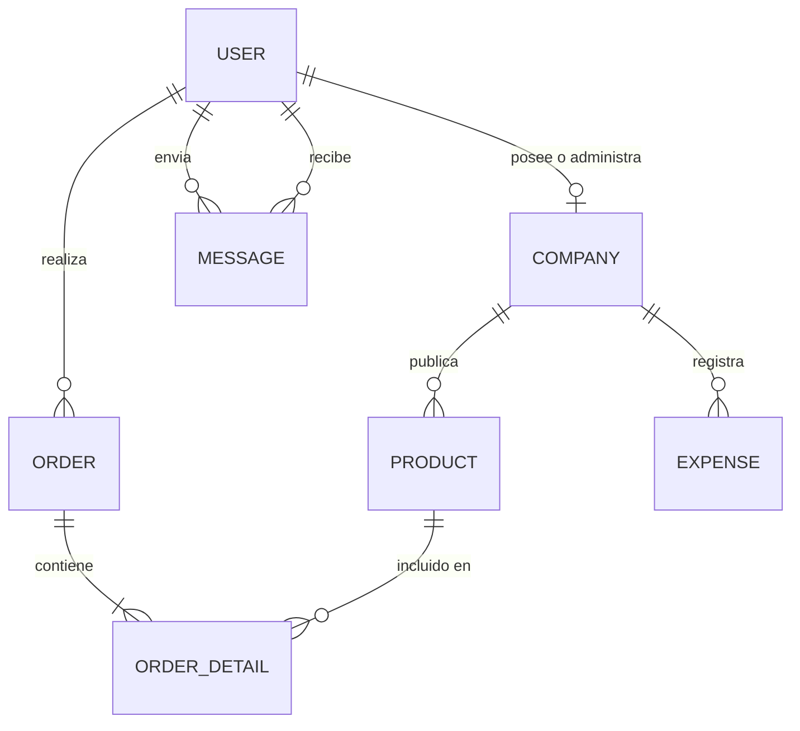
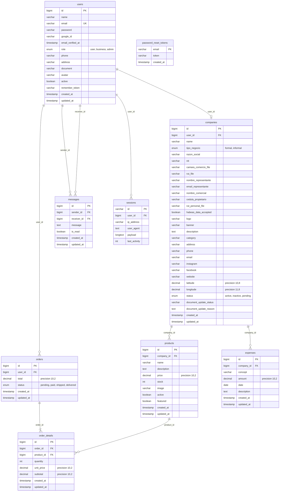
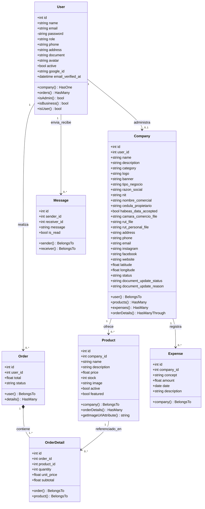
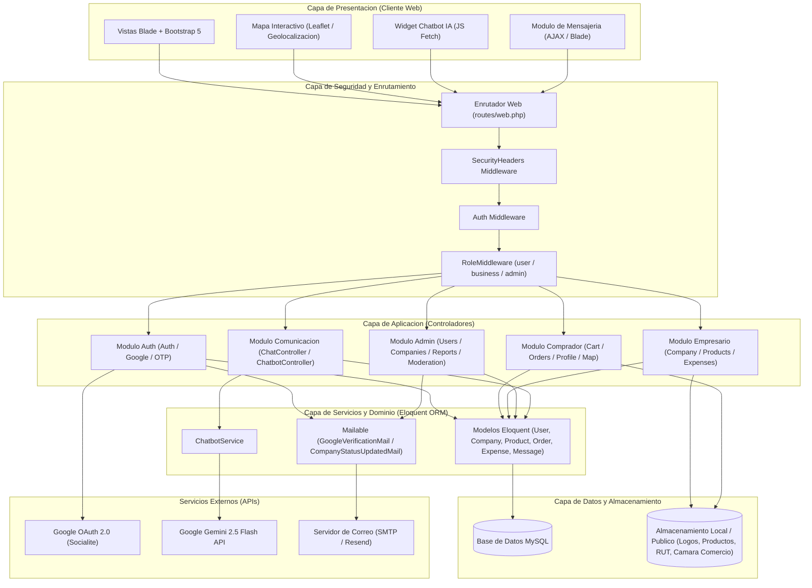
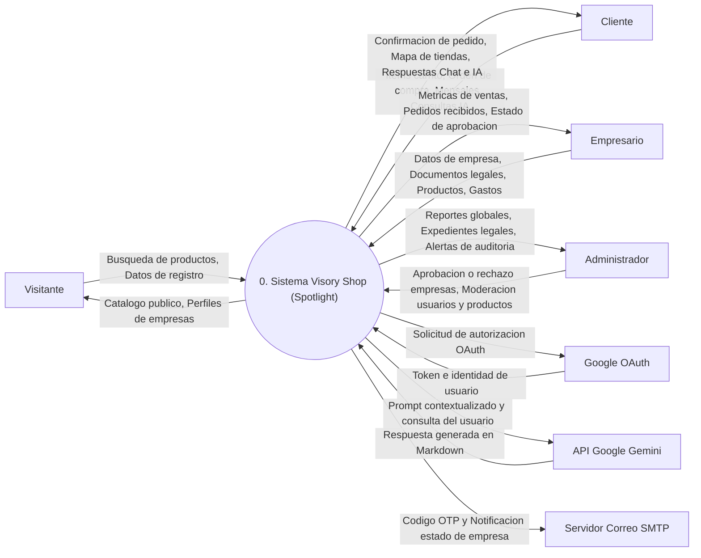
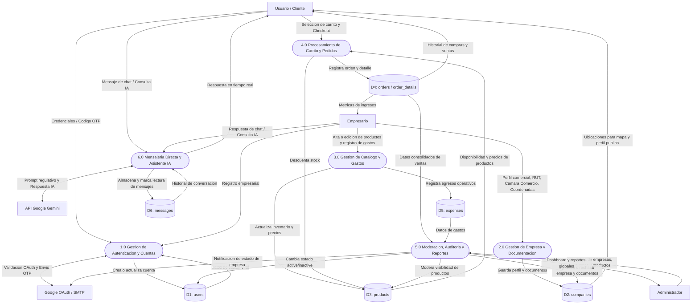

# 🏗️ Documentación de Arquitectura y Diagramas del Sistema - Visory Shop (Spotlight)

Documento técnico que reúne el **Diagrama Entidad-Relación (Conceptual)**, **Diagrama Físico de Base de Datos**, **Diagrama de Clases UML**, **Diagrama de Componentes** y **Diagramas de Flujo de Datos (DFD Nivel 0 y Nivel 1)** del proyecto **Visory Shop (Spotlight)**.

---

## 1. 🗂️ Diagrama Entidad-Relación (Modelo Conceptual)

Representa las entidades principales del dominio de negocio y la cardinalidad de sus relaciones conceptuales:

- Un **Usuario** (`USER`) con rol empresarial administra una **Empresa** (`COMPANY`) `(1:1)`.
- Un **Usuario** (`USER`) con rol comprador realiza cero o muchos **Pedidos** (`ORDER`) `(1:N)`.
- Un **Usuario** (`USER`) envía y recibe cero o muchos **Mensajes** (`MESSAGE`) `(1:N)`.
- Una **Empresa** (`COMPANY`) publica cero o muchos **Productos** (`PRODUCT`) `(1:N)`.
- Una **Empresa** (`COMPANY`) registra cero o muchos **Gastos Operativos** (`EXPENSE`) `(1:N)`.
- Un **Pedido** (`ORDER`) se compone de uno o muchos **Detalles de Pedido** (`ORDER_DETAIL`) `(1:N)`.
- Un **Producto** (`PRODUCT`) puede estar referenciado en cero o muchos **Detalles de Pedido** (`ORDER_DETAIL`) `(1:N)`.

---

## 2. 🗄️ Diagrama Físico de Base de Datos (Esquema Relacional)

Especificación detallada de todas las tablas de la base de datos relacional (MySQL), incluyendo llaves primarias (`PK`), llaves foráneas (`FK`), llaves únicas (`UK`) y tipos de datos exactos definidos en las migraciones de Laravel:

---

## 3. 🏛️ Diagramas de Clases UML

### 3.1 Diagrama de Clases de Dominio (Modelos Eloquent)

### 3.2 Diagrama de Clases de Aplicación (Controladores, Servicios y Middlewares)

```mermaid
classDiagram
    class Controller {
        <<abstract>>
    }

    class AuthController {
        +showLogin()
        +login(Request)
        +showRegister()
        +register(Request)
        +logout(Request)
    }

    class GoogleController {
        +redirectToGoogle()
        +handleGoogleCallback()
    }

    class EmailVerificationController {
        +notice()
        +showVerifyForm()
        +verify(Request)
        +resend(Request)
    }

    class CartController {
        +index()
        +add(Request, Product)
        +update(Request, Product)
        +remove(Product)
        +checkout()
        +processCheckout(Request)
    }

    class BusinessProductController {
        +index()
        +create()
        +store(Request)
        +edit(Product)
        +update(Request, Product)
        +destroy(Product)
    }

    class BusinessCompanyController {
        +edit()
        +update(Request)
        +requestDocumentUpdate(Request)
    }

    class BusinessExpenseController {
        +index()
        +store(Request)
        +destroy(Expense)
    }

    class AdminCompanyController {
        +index()
        +show(Company)
        +updateStatus(Request, Company)
        +approveDocumentUpdate(Company)
        +rejectDocumentUpdate(Request, Company)
    }

    class AdminUserController {
        +index()
        +create()
        +store(Request)
        +edit(User)
        +update(Request, User)
        +toggle(User)
        +destroy(User)
    }

    class ChatController {
        +index()
        +show(User)
        +send(Request, User)
        +unreadCount()
    }

    class ChatbotController {
        -ChatbotService chatbotService
        +sendMessage(Request)
    }

    class ChatbotService {
        -string apiKey
        -string apiUrl
        +sendMessage(string message, string lang) array
        -getSystemPrompt(string lang) string
    }

    class RoleMiddleware {
        +handle(Request, Closure, string role)
    }

    Controller <|-- AuthController
    Controller <|-- GoogleController
    Controller <|-- EmailVerificationController
    Controller <|-- CartController
    Controller <|-- BusinessProductController
    Controller <|-- BusinessCompanyController
    Controller <|-- BusinessExpenseController
    Controller <|-- AdminCompanyController
    Controller <|-- AdminUserController
    Controller <|-- ChatController
    Controller <|-- ChatbotController
    ChatbotController --> ChatbotService : utiliza
```

---

## 4. 🧩 Diagrama de Componentes y Arquitectura

Representa la arquitectura multicapa (MVC + Servicios) de **Visory Shop (Spotlight)** y sus integraciones con servicios externos:

---

## 5. 🔄 Diagramas de Flujo de Datos (DFD)

### 5.1 DFD Nivel 0 (Diagrama de Contexto)

Muestra el sistema **Visory Shop (Spotlight)** como un proceso central único y el intercambio de datos de entrada y salida con todas las entidades externas:

---

### 5.2 DFD Nivel 1 (Procesos Principales y Almacenes de Datos)

Descompone el sistema en sus **6 procesos principales**, mostrando cómo fluyen los datos entre actores externos, procesos internos y almacenes de datos (`D1` a `D6`):

